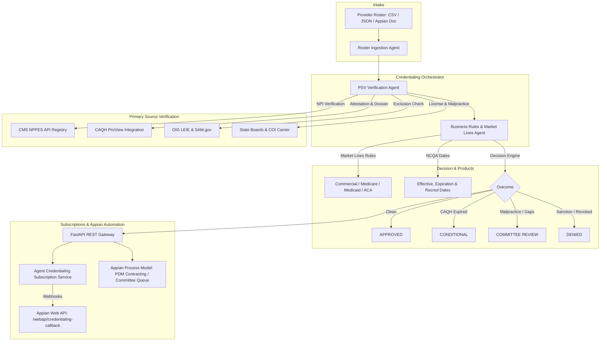

# Healthcare Provider Credentialing Approval Agentic System

An enterprise-grade, multi-agent automated credentialing and approval platform for Healthcare Provider Management Systems (PMS / PDM). Built to comply with **NCQA** (National Committee for Quality Assurance) and **CMS** (Centers for Medicare & Medicaid Services) standards, with native support for **Appian Process Automation** and an **Agent Credentialing Service Subscription API**.

> **Release Status**: ✅ Verified working agent UI code with automated `create_vm.bat` local environment.

---

## 🌟 Key Features

1. **Roster Ingestion Agent**:
   - Ingests standard provider rosters (CSV, JSON, or Appian Base64 documents).
   - Tolerant column normalizer supporting diverse payer/PMS naming conventions (`NPI`, `Tax ID`, `Specialty`, `Market Lines`).

2. **Primary Source Verification (PSV) Agent**:
   - **CMS NPPES Registry**: Validates NPI active status, Type 1 individual enumeration, deactivation flags, and primary taxonomy.
   - **CAQH ProView**: Verifies the strict NCQA 120-day attestation currency limit, attestation date, and profile completeness.
   - **State Medical Boards**: Validates state medical license status, expiration dates, and disciplinary actions.
   - **Education & Training**: Verifies medical school, residency, and fellowship.
   - **5-Year Work History & Gap Analysis**: Detects and flags unaddressed work gaps (> 6 months).
   - **Federal DEA & CDS**: Validates active registration, schedules (2-5), and expiration.
   - **Malpractice Liability Coverage**: Verifies carrier, $1M/$3M limits, and 5-year claims history.
   - **Federal Exclusions & Sanctions**: Verifies OIG-LEIE, SAM.gov debarments, and adverse disclosures.

3. **Business Market Lines & Decisioning Agent**:
   - Matches provider credentials and state practice location against business market lines and products:
     - **Commercial**: Commercial HMO Premier, Preferred PPO, Select EPO
     - **Medicare Advantage**: MA Choice HMO, MA Freedom PPO, Dual-Eligible Special Needs (D-SNP)
     - **Medicaid Managed Care**: Medicaid STAR, CHIP
     - **ACA Marketplace Exchange**: Individual & Family Plans
   - Enforces business credentialing criteria (e.g. Board Certification requirements for Medicare Advantage, practice state eligibility).
   - Computes standard NCQA **36-month credentialing terms**, effective dates, expiration dates, and 90-day recredentialing alerts.
   - Issues 4 distinct decisions:
     - `APPROVED`: Fully qualified; automatic contracting enabled.
     - `CONDITIONAL_APPROVAL`: Minor administrative delay (e.g., CAQH attestation > 120 days granted 30-day grace).
     - `COMMITTEE_REVIEW_REQUIRED`: Peer review docket triggered (malpractice history, work gaps).
     - `DENIED`: Hard disqualifiers (OIG exclusion, deactivated NPI, suspended license).

4. **Agent Credentialing Service Subscription API (NEW!)**:
   - Event-driven webhook subscription system for real-time Appian and PMS event integration.
   - Webhook events for: `BATCH_COMPLETED`, `CREDENTIALING_COMPLETED`, `RECREDENTIALING_ALERT`, `CAQH_EXPIRATION_ALERT`, `SANCTION_DETECTED`.
   - HMAC-SHA256 signature generation (`X-CredAgent-Signature`) and Bearer authentication.
   - Automated continuous monitoring scanner for 90-day recredentialing reminders and expired CAQH profiles.

5. **Appian Workflow Connector & Automation**:
   - REST API endpoints ready for Appian Connected Systems and HTTP Integration objects.
   - Pre-generated [OpenAPI 3.0 specification](appian/openapi.json) for 1-click import into Appian Designer.
   - Supports Appian Process Models, CDTs, Web API callbacks, and SAIL 360 Credentialing Interfaces.

6. **Full Visual Studio Code (VS Code) Local Support**:
   - Ready to import and run directly in VS Code.
   - Pre-configured launch configurations (`.vscode/launch.json`), tasks (`.vscode/tasks.json`), settings (`.vscode/settings.json`), and automated Windows setup scripts (`setup.ps1` / `setup.bat`).

---

## 🏗️ Architecture



---

## 📁 Repository Structure

```
provider_cred_agent/
├── .vscode/
│   ├── launch.json                 # Pre-configured 1-click VS Code debug targets
│   ├── settings.json               # VS Code workspace settings & pytest config
│   ├── tasks.json                  # VS Code quick tasks (build, test, run)
│   └── extensions.json             # Recommended VS Code extensions
├── agents/
│   ├── roster_ingestion_agent.py   # Roster intake & column normalizer
│   ├── psv_verification_agent.py   # Primary Source Verification (NPI, CAQH, etc.)
│   ├── business_rules_agent.py     # Market lines & credentialing decision rules
│   └── credentialing_orchestrator.py # Master coordinator agent
├── api/
│   └── appian_api.py               # FastAPI service for Appian & Subscriptions
├── appian/
│   ├── openapi.json                # OpenAPI 3.0 spec for 1-click Appian import
│   └── appian_integration_guide.md # Complete step-by-step Appian developer guide
├── config/
│   └── market_lines_config.json    # Business market lines, products, tiers & rules
├── data/
│   ├── sample_provider_roster.csv  # Multi-scenario test roster (CSV)
│   ├── sample_provider_roster.json # Multi-scenario test roster (JSON)
│   └── subscriptions.json          # Persistent subscription store
├── docs/
│   ├── BLUEPRINT_REQUIREMENTS_DOCUMENT.md # Functional Requirements Specification & Blueprint
│   ├── STANDALONE_UI_WORKFLOW_GUIDE.md   # Guide for running UI without Appian
│   ├── LOCAL_SETUP_AND_RUN_GUIDE.md      # Local setup, VS Code, CLI, and Docker guide
│   ├── TECHNICAL_DESIGN_DOCUMENT.md      # Full Technical Design Document (TDD)
│   ├── CLOUD_PRODUCTION_DEPLOYMENT_GUIDE.md # Production GCP deployment & HIPAA guide
│   └── AGENTIC_AI_TECHNICAL_LEARNINGS.md # Agentic AI concepts, MAS, & Low-Code synergy
├── models/
│   ├── provider_models.py          # Provider, NPI & CAQH schemas
│   ├── credentialing_models.py     # Decision, market lines & PSV schemas
│   └── subscription_models.py      # Webhook subscriptions & payload schemas
├── services/
│   ├── npi_service.py              # NPPES CMS live API & Luhn validator
│   ├── caqh_service.py             # CAQH ProView extraction service
│   ├── sanctions_service.py        # OIG LEIE & SAM.gov exclusion checks
│   └── subscription_service.py     # Webhook dispatcher & HMAC security
├── tests/
│   └── test_cred_agent.py          # Pytest automated test suite (12 tests)
├── ui/
│   ├── app.py                      # Standalone Operations & Committee Portal (Streamlit)
│   └── portal.html                 # Embedded Web Workbench (FastAPI at /ui)
├── Vagrantfile                     # Turnkey Ubuntu 22.04 LTS VM configuration
├── create_vm.bat                   # 1-click Local VM Creator & Provisioner (Interactive/CLI)
├── create_vm.ps1                   # Companion PowerShell VM Provisioner
├── vm_start_api.bat                # Start FastAPI Web Workbench bound to 0.0.0.0:8000
├── vm_start_ui.bat                 # Start Streamlit Committee Portal bound to 0.0.0.0:8501
├── vm_run_all.bat                  # Concurrently start all services in VM and launch host browser
├── scripts/
│   ├── provision_hyperv.ps1        # Hyper-V internal switch, NAT & port-mapping provisioner
│   └── provision_wsl.sh            # WSL2 Linux environment provisioner
├── Dockerfile                      # Multi-stage secure production Dockerfile
├── docker-compose.yml              # Local container stack for API and UI
├── .dockerignore                   # Build exclusion rules
├── requirements.txt                # Pinned dependencies
├── run_agent.py                    # Standalone CLI / UI launcher (--ui, --web, --host, --port)
├── run_ui.bat                      # 1-click Windows batch script to launch UI
├── run_ui.ps1                      # 1-click PowerShell script to launch UI
├── setup.ps1                       # 1-click Windows PowerShell setup script
├── setup.bat                       # 1-click Windows batch setup script
└── README.md
```

---

## 🖥️ Running in a Local Virtual Machine (VM)

You can run the entire agentic credentialing platform inside an isolated local Virtual Machine (VM) or container sandbox using the automated VM creator:

### 1-Click VM Creation & Provisioning
Double-click [`create_vm.bat`](file:///c:/Users/866223/.gemini/antigravity/scratch/provider_cred_agent/create_vm.bat) or execute from terminal:

```bat
# Interactive VM Wizard:
create_vm.bat

# Direct Provisioning Modes:
create_vm.bat --venv       # Create & provision Python VM sandbox (.venv) [Instant]
create_vm.bat --hyperv     # Provision Windows Hyper-V VM with internal NAT
create_vm.bat --wsl        # Provision and run inside WSL2 Linux VM
create_vm.bat --vagrant    # Launch Vagrant / VirtualBox Ubuntu 22.04 VM
create_vm.bat --test       # Run test suite inside VM
create_vm.bat --start      # Concurrently launch all VM services
```

### VM Helper Launchers:
- **FastAPI Web Workbench**: [`vm_start_api.bat`](file:///c:/Users/866223/.gemini/antigravity/scratch/provider_cred_agent/vm_start_api.bat) (Binds to `0.0.0.0:8000`)
- **Streamlit Committee Portal**: [`vm_start_ui.bat`](file:///c:/Users/866223/.gemini/antigravity/scratch/provider_cred_agent/vm_start_ui.bat) (Binds to `0.0.0.0:8501`)
- **Launch Everything**: [`vm_run_all.bat`](file:///c:/Users/866223/.gemini/antigravity/scratch/provider_cred_agent/vm_run_all.bat) (Opens both services and host browser)

For complete architectural details, see the **[Local VM Execution & Provisioning Guide](docs/VM_LOCAL_RUN_GUIDE.md)**.

---

## 🖥️ Running the UI (Standalone Workflow Without Appian)

You do **not** need Appian to run this system. The project provides two fully-functional standalone UI tools:

### Option 1: Operations & Committee Portal (Streamlit - Recommended)
A full-featured Operations Portal with Roster Intake, Human-in-the-Loop Committee Review, Case Management, MEC Docket Export, and Adverse Action Notice generation.
- **1-Click Batch Script**: Double-click `run_ui.bat`
- **PowerShell**: `.\run_ui.ps1`
- **Python CLI**: `python run_agent.py --ui` or `streamlit run ui/app.py`
- **Browser URL**: **`http://localhost:8501`**

### Option 2: Embedded Web Operations Workbench (FastAPI)
Zero-dependency single-page web dashboard served directly by the API backend:
- **Python CLI**: `python run_agent.py --web` or `python -m uvicorn api.appian_api:app --reload`
- **Browser URL**: **`http://localhost:8000/ui`**

For complete step-by-step instructions on operating the system entirely through the UI, see the [Standalone UI Workflow Guide](docs/STANDALONE_UI_WORKFLOW_GUIDE.md).

---

## 💻 Running Locally in Visual Studio Code (VS Code)

### Option A: Using the Automated Setup Script
1. Open PowerShell in the project directory:
   ```powershell
   cd C:\Users\866223\.gemini\antigravity\scratch\provider_cred_agent
   .\setup.ps1
   ```
   *(Or double-click `setup.bat` in Windows File Explorer)*.

### Option B: Using VS Code Directly
1. Open the project folder in VS Code:
   ```powershell
   code C:\Users\866223\.gemini\antigravity\scratch\provider_cred_agent
   ```
2. Press **Ctrl + Shift + P** and select **Tasks: Run Task > 📦 Install Dependencies**.
3. Press **F5** to run any of the pre-configured targets:
   - **`🌐 1. Run Web Workbench & API (FastAPI: http://localhost:8000/ui)`**: Starts REST API and embedded web workbench.
   - **`🏥 2. Run Operations & Committee Portal (Streamlit: http://localhost:8501)`**: Starts the complete interactive operations portal.
   - **`📋 3. Run CLI Batch Roster Process`**: Runs credentialing against `data/sample_provider_roster.csv`.
   - **`🧪 4. Run Pytest Test Suite`**: Executes all 12 unit and integration tests.

---

## ⚡ Using the Agent in Appian Workflow

For detailed instructions, refer to the [Appian Integration Guide](appian/appian_integration_guide.md).

### Summary of Appian Integration Steps:
1. **Import OpenAPI**: In Appian Designer, click **New > Integration > Create from OpenAPI** and select [`appian/openapi.json`](appian/openapi.json).
2. **Configure Connected System**: Set Base URL to `http://<your-server-host>:8000`.
3. **Register Webhook Subscription**:
   Send a `POST` request to `/api/v1/subscriptions` with your Appian Web API URL (`/suite/webapi/credentialing-callback`) to receive real-time push notifications on batch completions, credentialing approvals, and 90-day recredentialing warnings.
4. **Trigger from Process Model**:
   - Ingest uploaded roster documents using `POST /api/v1/roster/process-base64` or on-demand providers via `POST /api/v1/provider/credential`.
5. **XOR Decision Routing**:
   - `APPROVED` ➔ Write to Provider Data Store & trigger network contracting.
   - `CONDITIONAL_APPROVAL` ➔ Create 30-Day CAQH re-attestation task & timer.
   - `COMMITTEE_REVIEW_REQUIRED` ➔ Route to Appian Credentialing Peer Review Queue.
   - `DENIED` ➔ Automatically generate Adverse Action notice letter.

---

## 📖 Technical Documentation

* **[Local Virtual Machine (VM) Run & Provisioning Guide](docs/VM_LOCAL_RUN_GUIDE.md)**: 1-click VM creation, Vagrant, Hyper-V, WSL2, host networking, and port binding.
* **[Local Project Setup & Run Guide](docs/LOCAL_SETUP_AND_RUN_GUIDE.md)**: Turnkey local setup, VS Code 1-click execution, CLI commands, Docker Compose, and troubleshooting recipes.
* **[Standalone UI Workflow Guide](docs/STANDALONE_UI_WORKFLOW_GUIDE.md)**: Full guide to operating the platform using Streamlit Operations Portal and FastAPI Web Workbench without Appian.
* **[Blueprint & Requirements Document (FRS)](docs/BLUEPRINT_REQUIREMENTS_DOCUMENT.md)**: Comprehensive business blueprint, functional requirements (FR-1 to FR-8), NFRs, traceability matrix, and Appian process blueprint.
* **[Technical Design Document (TDD)](docs/TECHNICAL_DESIGN_DOCUMENT.md)**: Full architecture specification, NCQA/CMS compliance rules, database/CDT schemas, HMAC security, and sequence diagrams.
* **[Cloud Production Deployment Guide (GCP)](docs/CLOUD_PRODUCTION_DEPLOYMENT_GUIDE.md)**: Step-by-step production deployment to Google Cloud Platform (Cloud Run, HIPAA compliance, Secret Manager, Cloud Armor WAF, CI/CD, and Appian Cloud connectivity).
* **[Agentic AI Technical Learnings & Concepts](docs/AGENTIC_AI_TECHNICAL_LEARNINGS.md)**: Comprehensive deep dive on Agentic AI vs. Chatbots/Scripts, Multi-Agent System (MAS) architecture, technology choices, and Low-Code + Agentic AI synergy.
* **[Appian Integration Guide](appian/appian_integration_guide.md)**: Step-by-step Appian developer guide, Process Model patterns, Web API callback configuration, and SAIL interface code.

