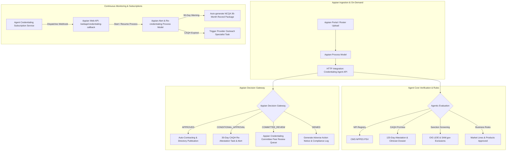
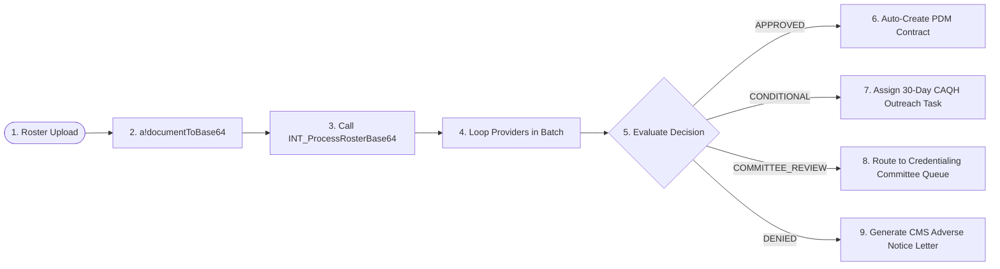

# Appian Workflow Integration & Credentialing Service Subscription Guide

This guide provides technical specifications, integration steps, and code patterns to connect and automate the **Provider Credentialing Approval Agent** and its **Agent Credentialing Service Subscription API** inside **Appian**.

---

## 1. End-to-End Appian Orchestration Architecture



---

## 2. Connected System Configuration

1. In **Appian Designer**, click **New > Connected System**.
2. Select **HTTP Connected System**.
3. Configure the fields:
   - **Name**: `CS_ProviderCredentialingAgent`
   - **Description**: `Connected System for Agentic Healthcare Provider Credentialing Verification & Subscriptions`
   - **Base URL**: `http://localhost:8000` (or your deployed cloud container URL)
   - **Authentication**: `None` or `API Key` in Header (`X-API-Key`)
4. Verify by clicking **Test Connection** against `GET /api/v1/health`.

---

## 3. Appian Integration Objects

You can import [`appian/openapi.json`](file:///C:/Users/866223/.gemini/antigravity/scratch/provider_cred_agent/appian/openapi.json) directly into Appian (**New > Integration > Create from OpenAPI**), or configure the following integration objects manually:

### Integration 1: `INT_CredentialSingleProvider`
- **Method**: `POST`
- **Relative Path**: `/api/v1/provider/credential`
- **Headers**: `Content-Type: application/json`
- **Request Body Expression**:
  ```json
  {
    "npi": "1234567893",
    "first_name": "Sarah",
    "last_name": "Conner",
    "caqh_id": "14892011",
    "tin": "74-8899123",
    "group_name": "Austin Family Health Partners",
    "specialty": "Family Medicine",
    "practice_state": "TX",
    "requested_products": ["Commercial HMO", "Commercial PPO", "Medicare Advantage", "Medicaid"],
    "appian_case_id": "pv!caseId"
  }
  ```

### Integration 2: `INT_ProcessRosterBase64`
- **Method**: `POST`
- **Relative Path**: `/api/v1/roster/process-base64`
- **Headers**: `Content-Type: application/json`
- **Request Body Expression**:
  ```json
  {
    "filename": ri!rosterDocument.name,
    "base64_content": a!documentToBase64(ri!rosterDocument)
  }
  ```

### Integration 3: `INT_RegisterWebhookSubscription`
- **Method**: `POST`
- **Relative Path**: `/api/v1/subscriptions`
- **Headers**: `Content-Type: application/json`
- **Request Body Expression**:
  ```json
  {
    "client_name": "Appian Healthcare PDM Process Model",
    "webhook_url": "https://myhealthplan.appiancloud.com/suite/webapi/credentialing-callback",
    "subscribed_events": ["BATCH_COMPLETED", "CREDENTIALING_COMPLETED", "RECREDENTIALING_ALERT", "CAQH_EXPIRATION_ALERT"],
    "auth_token": "appian-service-account-token",
    "secret_key": "appian-shared-hmac-secret",
    "is_active": true
  }
  ```

---

## 4. Appian Web API: Receiving Webhook Events

When events happen (batch completion, on-demand decisions, 90-day recredentialing alerts, or expiring CAQH), the agent dispatches an HTTP POST to your **Appian Web API**.

### Web API Configuration (`WAPI_CredentialingEventCallback`):
- **Endpoint**: `/suite/webapi/credentialing-callback`
- **HTTP Method**: `POST`
- **Security**: Service account token or Basic Auth.
- **SAIL Expression**:
```sail
/* Appian Web API: WAPI_CredentialingEventCallback */
a!localVariables(
  local!payload: a!fromJson(http!request.body),
  local!eventType: http!request.headers["x-credagent-event"],
  local!signature: http!request.headers["x-credagent-signature"],
  
  /* Validate event type and trigger appropriate Appian Process Model */
  a!match(
    value: local!eventType,
    
    /* 1. Batch Roster Completed */
    equals: "BATCH_COMPLETED",
    then: {
      a!startProcess(
        processModel: cons!PM_ROSTER_INGESTION_SUMMARY,
        processParameters: {
          batchId: local!payload.data.batch_id,
          totalProviders: local!payload.data.total_providers,
          approvedCount: local!payload.data.approved_count,
          deniedCount: local!payload.data.denied_count
        }
      ),
      a!httpResponse(statusCode: 200, body: a!toJson({status: "BATCH_ACKNOWLEDGED"}))
    },
    
    /* 2. Re-credentialing 90-Day Alert */
    equals: "RECREDENTIALING_ALERT",
    then: {
      a!startProcess(
        processModel: cons!PM_INITIATE_RECREDENTIALING_CYCLE,
        processParameters: {
          npi: local!payload.data.npi,
          providerName: local!payload.data.provider_name,
          dueDate: local!payload.data.recredentialing_due_date,
          daysRemaining: local!payload.data.days_remaining
        }
      ),
      a!httpResponse(statusCode: 200, body: a!toJson({status: "RECRED_CYCLE_INITIATED"}))
    },

    /* 3. CAQH Attestation Expiring / Expired Alert */
    equals: "CAQH_EXPIRATION_ALERT",
    then: {
      a!startProcess(
        processModel: cons!PM_PROVIDER_CAQH_OUTREACH,
        processParameters: {
          npi: local!payload.data.npi,
          providerName: local!payload.data.provider_name,
          daysSinceAttestation: local!payload.data.days_since_attestation,
          caqhStatus: local!payload.data.status
        }
      ),
      a!httpResponse(statusCode: 200, body: a!toJson({status: "OUTREACH_TASK_ASSIGNED"}))
    },
    
    /* Default Handler */
    default: a!httpResponse(statusCode: 200, body: a!toJson({status: "EVENT_PROCESSED"}))
  )
)
```

---

## 5. Appian Process Model Automation Patterns

### Process Model 1: **"PM_ProviderRosterIngestion"**


### Process Model 2: **"PM_CredentialingCommitteeReview"**
- **Trigger**: When an individual provider or roster item returns `COMMITTEE_REVIEW_REQUIRED`.
- **User Input Task**: Sent to Credentialing Committee Queue.
- **Form**: Presents the Agent's PSV dossier, highlighting specific committee flags (e.g., malpractice settlements $> \$50\text{k}$, 8-month employment gap).
- **Actions**: Approve, Approve with Monitoring, or Decline.

---

## 6. Sample SAIL Interface: Provider Credentialing 360 View

```sail
/* Appian SAIL Interface: Provider Credentialing 360 Cockpit */
a!localVariables(
  local!providerResult: rule!CRED_getProviderDecision(npi: ri!npi),
  
  a!sectionLayout(
    label: "Provider Credentialing Dossier & Decision Summary",
    contents: {
      a!columnsLayout(
        columns: {
          a!columnLayout(
            contents: {
              a!textField(label: "Provider Name", value: local!providerResult.provider_name, readOnly: true),
              a!textField(label: "NPI", value: local!providerResult.npi, readOnly: true),
              a!textField(label: "CAQH ProView ID", value: local!providerResult.caqh_id, readOnly: true)
            }
          ),
          a!columnLayout(
            contents: {
              a!tagField(
                label: "Credentialing Decision",
                tags: a!tagItem(
                  text: local!providerResult.overall_decision,
                  backgroundColor: choose(
                    wherecontains(local!providerResult.overall_decision, {"APPROVED", "CONDITIONAL_APPROVAL", "COMMITTEE_REVIEW_REQUIRED", "DENIED"}),
                    "#e6f4ea", "#fef7e0", "#ffedd5", "#fce8e6"
                  )
                )
              ),
              a!dateField(label: "NCQA Re-Credentialing Due", value: local!providerResult.recredentialing_due_date, readOnly: true),
              a!textField(label: "Decision Rationale", value: local!providerResult.decision_summary, readOnly: true)
            }
          )
        }
      ),
      
      /* Approved Market Lines Grid */
      a!gridField(
        label: "Approved Market Lines & Products (Effective Dates & Tiers)",
        data: local!providerResult.approved_market_lines,
        columns: {
          a!gridColumn(label: "Market Line", value: fv!row.market_line),
          a!gridColumn(label: "Product Name", value: fv!row.product_name),
          a!gridColumn(label: "Plan Code", value: fv!row.plan_code),
          a!gridColumn(label: "Network Tier", value: fv!row.network_tier),
          a!gridColumn(label: "Effective Date", value: fv!row.effective_date),
          a!gridColumn(label: "Expiration Date", value: fv!row.expiration_date),
          a!gridColumn(label: "Status", value: fv!row.status)
        }
      ),

      /* Primary Source Verification Checklist */
      a!gridField(
        label: "Primary Source Verification (PSV) Audit Checklist",
        data: local!providerResult.psv_checks,
        columns: {
          a!gridColumn(label: "Verification Check", value: fv!row.check_name),
          a!gridColumn(label: "Data Source", value: fv!row.source),
          a!gridColumn(label: "Result", value: fv!row.status),
          a!gridColumn(label: "Details & Findings", value: fv!row.details)
        }
      )
    }
  )
)
```
