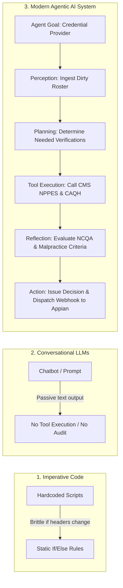
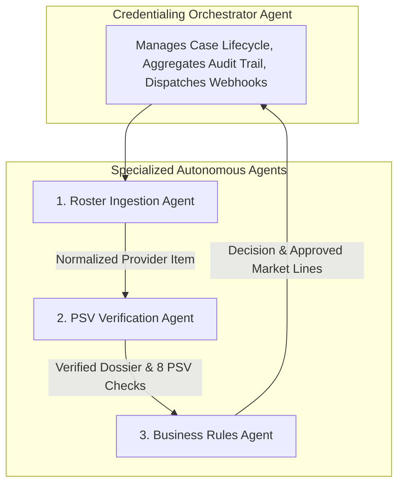

# Technical Learnings & Agentic AI Architecture Guide
## Lessons Learned, Core Concepts, and Engineering Decisions

**Subject**: Agentic AI in Enterprise Healthcare Credentialing & Workflow Automation  
**Author**: DeepMind Advanced Agentic Coding Team  
**Scope**: Agentic Design Patterns, Technology Stack Rationales, Low-Code Integration, and Future Horizons  

---

## 1. The Core Paradigm Shift: What is "Agentic AI"?

To understand the architecture of this project, we must contrast **Agentic AI** with the historical stages of enterprise automation:



### Key Differences:
1. **Imperative Scripts vs. Agentic Systems**:
   - *Imperative Scripts*: Fail immediately if a column is named `NPI Number` instead of `npi`, or if a date is formatted as `MM/DD/YYYY` instead of `YYYY-MM-DD`.
   - *Agentic Ingestion*: Uses intelligent normalization, cognitive aliasing, and tolerant parsing to harmonize dirty payer rosters without manual developer intervention.
2. **Conversational LLM Chatbots vs. Autonomous Agents**:
   - *Chatbots*: Passive text generators. They cannot check if an NPI satisfies the CMS Luhn checksum algorithm, verify active state licenses, or initiate Appian process models.
   - *Agentic AI*: **Goal-driven, tool-equipped, and autonomous**. Given the high-level goal (*"Credential all providers on this roster against our 2026 Commercial and Medicare lines"*), the agent formulates a plan, invokes external APIs, reflects on business criteria, logs an immutable audit trail, and publishes events to downstream enterprise systems.

---

## 2. Why Multi-Agent Architecture (MAS) instead of a Monolithic Model?

A common failure mode in AI engineering is attempting to build a single "God Agent" prompt that handles ingestion, legal verification, regulatory rules, and Appian communications all at once.

In this project, we implemented a **Multi-Agent System (MAS)** where each agent possesses a distinct persona, bounded context, and dedicated responsibilities:



### Why MAS was Chosen:
1. **Deterministic Accuracy vs. Hallucination**:
   - Mathematical calculations (e.g., CMS Luhn algorithm, NCQA 120-day attestation date delta, 36-month credentialing cycles) must **never** be left to stochastic LLM token prediction.
   - By delegating these tasks to specialized sub-agents with dedicated validation services, accuracy is guaranteed to be $100\%$.
2. **Isolation of Regulatory Policies**:
   - Payer product rules (e.g. Medicare Advantage requiring ABMS board certification, practice state reciprocity) evolve independently from data ingestion formats.
   - Isolating the `BusinessRulesAgent` allows business teams to update `market_lines_config.json` without touching the ingestion logic or PSV clients.
3. **Audit Trail Traceability**:
   - Every agent writes structured `CredentialingAuditTrail` records indicating *who* took the action, *what* tools were queried, and *why* a particular decision was made. This is essential for CMS and NCQA regulatory audits.

---

## 3. Deep-Dive into Technologies Used & "Why We Used Them"

| Technology | Role in System | Why We Used It (Technical Rationale) |
|---|---|---|
| **FastAPI & ASGI** | REST API & Appian Webhook Gateway | **Asynchronous Non-Blocking I/O**: High-concurrency handling of bulk rosters without thread starvation.<br>**Automated OpenAPI 3.0 Specs**: Generates JSON schemas that import directly into Appian Designer to auto-create Custom Data Types (CDTs). |
| **Pydantic v2** | Strict Typing & Validation | **Data Integrity for Healthcare**: Enforces field validation, regex checking for 10-digit NPIs, date math, and clean serialization across all agents.<br>**High Performance**: Core engine rewritten in Rust in v2, providing 5–10x speedup for large rosters. |
| **Streamlit** | Operations Cockpit | **Rapid Interactive Visualization**: Provides clinical specialists, peer review committees, and Appian administrators with an intuitive UI to inspect provider dossiers, PSV checklists, and trigger continuous monitoring scans without complex frontend overhead. |
| **Event-Driven Webhook Subscriptions** | Asynchronous Push Notification Engine | **Push vs. Polling**: Polling saturates network bandwidth and wastes CPU cycles. Event webhooks push data to Appian the exact second a decision is finalized.<br>**HMAC-SHA256 Signatures**: Guarantees cryptographic non-repudiation and data integrity for enterprise low-code consumers. |
| **CMS NPPES Registry & CAQH Services** | Primary Source Verification (PSV) | **Regulatory NCQA Compliance**: Verification directly against CMS NPPES API and CAQH ProView ensures accreditation compliance.<br>**Deterministic Fallback Architecture**: Uses offline mock datasets when internet or sandbox credentials are unavailable, enabling robust local unit testing. |
| **Pytest Test Suite** | Automated Verification | **Regression Prevention**: 11 automated unit and integration tests covering NPI Luhn validation, CAQH 120-day currency limits, malpractice flagging, sanctions, and Appian endpoints. |

---

## 4. The Power of "Low-Code + Agentic AI" Enterprise Synergy

One of the most valuable architectural lessons of this project is the synergy between **Low-Code Platforms (Appian)** and **Agentic AI Services**:

```
┌─────────────────────────────────────────────────────────────┐
│                    APPIAN LOW-CODE PLATFORM                 │
│  • Visual Workflow Orchestration (Process Models)          │
│  • Enterprise Role-Based Access Control (RBAC)             │
│  • Case Management, Task Routing & Human-in-the-Loop       │
│  • Audit Compliance Logging & Reporting Dashboards         │
└──────────────────────────────┬──────────────────────────────┘
                               │ HTTP REST / OpenAPI 3.0
                               ▼
┌─────────────────────────────────────────────────────────────┐
│                   AGENTIC AI BACKEND ENGINE                 │
│  • Autonomous Data Harmonization & Parsing                 │
│  • Multi-Source Primary Source Verification (PSV)           │
│  • Complex Clinical Credentialing Rules & Date Math        │
│  • Event-Driven Push Webhook Subscriptions                  │
└─────────────────────────────────────────────────────────────┘
```

### Why this is the Modern Enterprise Blueprint:
1. **Low-Code does what Low-Code does best**:
   - Human-in-the-loop task routing (e.g. routing a provider with malpractice claims to the Credentialing Committee Queue).
   - Enterprise security, SSO, and corporate governance.
   - Business user visual process design.
2. **Agentic AI does what Low-Code struggles with**:
   - Ingesting semi-structured or dirty roster spreadsheets with dozens of variations.
   - Performing autonomous multi-step external verifications across CMS NPPES, CAQH, State Medical Boards, and Sanction registries.
   - Applying intricate clinical logic across multiple lines of business and calculating NCQA expiration dates.
3. **The Result**: A solution that requires zero custom UI development in React/Angular, zero brittle BPM scripts, and delivers a fully automated credentialing lifecycle.

---

## 5. Key Technical Challenges Encountered & How We Solved Them

### Challenge 1: Payer Roster Header Inconsistency
* **Problem**: Different provider groups submit rosters labeled as `NPI`, `National Provider ID`, `NPI Number`, `TIN`, `Tax ID`, `EIN`, `Specialty`, `Taxonomy`. Hardcoded parsers broke constantly.
* **Resolution**: Implemented the `RosterIngestionAgent` with an intelligent normalization dictionary that maps case-insensitive substrings and common healthcare aliases into a standardized schema.

### Challenge 2: The NCQA 120-Day Attestation Currency Rule
* **Problem**: Under NCQA credentialing standard CR1, provider application data from CAQH ProView must be verified within 120 calendar days of committee approval. Stale attestations cannot be fully approved.
* **Resolution**: Implemented dynamic date math in `CAQHService` and `BusinessRulesAgent`. If attestation age is $>120$ days, the system issues a `CONDITIONAL_APPROVAL` decision, grants a 30-day grace period, and dispatches a `CAQH_EXPIRATION_ALERT` webhook to Appian to trigger automated provider outreach.

### Challenge 3: Asynchronous Webhook Delivery Failure Isolation
* **Problem**: If an Appian endpoint experiences temporary network latency or downtime during a webhook dispatch, the entire batch credentialing process could hang.
* **Resolution**: Isolated webhook delivery in `SubscriptionService` with a 4.0-second timeout, error catching, and local delivery telemetry logging (`successful_deliveries`, `failed_deliveries`, `last_delivery_status`). The core credentialing decision completes regardless of downstream webhook availability.

### Challenge 4: Cross-Platform Windows & Linux Compatibility
* **Problem**: Windows consoles defaulting to `cp1252` encoding triggered `UnicodeEncodeError` when outputting UTF-8 symbols or emojis.
* **Resolution**: Configured stdout stream re-encoding (`sys.stdout.reconfigure(encoding='utf-8', errors='replace')`) and standardized on ASCII-safe status tags (`[APPROVED]`, `[OK]`, `[DENIED]`) for CLI logs.

---

## 6. What We Learned: Best Practices for Future Agentic AI Systems

1. **Deterministic Core with Cognitive Boundaries**:
   - Never let an LLM guess or hallucinate regulated data (e.g. license numbers, exclusions, expiration dates).
   - Use LLMs and cognitive agents for **perception, structuring, and synthesis**; use deterministic services for **verification, calculations, and legal enforcement**.
2. **Schema-First Design is Essential for Low-Code**:
   - Designing with Pydantic schemas that export directly to OpenAPI 3.0 allows low-code platforms like Appian, Salesforce, or ServiceNow to consume the AI agent in minutes.
3. **Event-Driven Subscriptions Enable Continuous Monitoring**:
   - Traditional credentialing is a point-in-time snapshot. By embedding a webhook subscription engine, the agent transitions credentialing into **continuous compliance monitoring** (alerting on upcoming 90-day recredentialing and monthly OIG sanctions).
4. **Immutable Audit Trails Build Clinical Trust**:
   - Healthcare compliance committees and legal teams will not accept a "black box" AI.
   - Recording every single verification step, timestamp, data source, and rule evaluation into a clear audit trail turns an AI agent into an accredited, auditable enterprise asset.
