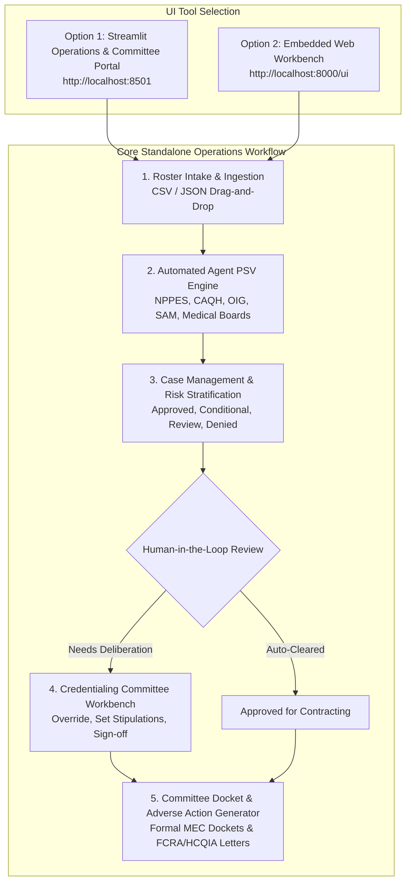

# Standalone Credentialing UI Workflow Guide
## Healthcare Provider Credentialing Approval Agent

This guide outlines how to run and operate the **Healthcare Provider Credentialing Approval Agent** using modern, interactive **UI tools instead of the Appian UI workflow**.

---

## 1. Executive Summary: Operating Without Appian

While this agent includes pre-built REST endpoints and an OpenAPI schema for Appian integration, **Appian is completely optional**. You can execute 100% of the credentialing lifecycle—from intake and primary source verification to human committee peer reviews, docket generation, and adverse action letters—using the included standalone UI tools.



---

## 2. Available UI Tools Comparison

| Feature | Option 1: Streamlit Operations & Committee Portal | Option 2: Embedded FastAPI Web Workbench | Appian UI Workflow |
|---|---|---|---|
| **Primary URL** | `http://localhost:8501` | `http://localhost:8000/ui` | Appian Cloud URL |
| **Technology** | Python / Streamlit | HTML5 / Tailwind / JavaScript | Appian SAIL / BPM |
| **Requires Appian License?** | ❌ **No (Free / Open Source)** | ❌ **No (Zero dependencies beyond API)** | ✅ Yes (Commercial) |
| **Roster Ingestion** | ✅ Drag & drop CSV/JSON + Sample | ✅ File upload + 1-Click Sample | ✅ Appian Portal / Sites |
| **Search & Status Filters** | ✅ Real-time NPI/Name search & filters | ✅ Real-time metrics & table | ✅ Appian Record Type |
| **Committee Peer Review Workbench** | ✅ Full human sign-off, notes & stipulations | ℹ️ Dossier inspection & status | ✅ Appian Task Queue |
| **Formal MEC Docket Export** | ✅ 1-Click Markdown / Report download | ℹ️ Summary metrics | ✅ Appian Document Generation |
| **Adverse Action Letters** | ✅ Formatted HCQIA notice generator | ℹ️ Status indication | ✅ Appian Document Generation |
| **Continuous Monitoring Scans** | ✅ Interactive 90-day alert scanner | ✅ 1-Click alert scanner | ✅ Appian Process Model Timer |
| **Market Lines Rules Editor** | ✅ Interactive product & tier viewer | ℹ️ API view | ✅ Appian Expression Rules |

---

## 3. How to Launch the UI (Choose Any Method)

### Method A: 1-Click Windows Batch Script (Fastest)
Double-click `run_ui.bat` in the project root, or execute:
```cmd
run_ui.bat
```
*Automatically opens in your browser at `http://localhost:8501`.*

### Method B: PowerShell Script
```powershell
.\run_ui.ps1
```

### Method C: Unified Python Runner
Use the `--ui` flag on the project's central runner:
```bash
python run_agent.py --ui
```
Or use the `--web` flag to start the embedded web portal:
```bash
python run_agent.py --web
```
*(Browse to `http://localhost:8000/ui`)*

### Method D: Direct Streamlit CLI
```bash
streamlit run ui/app.py
```

### Method E: VS Code 1-Click Debugging
1. Open the project in VS Code.
2. Press **Ctrl + Shift + D** (Run & Debug).
3. Select **`🏥 2. Run Operations & Committee Portal (Streamlit: http://localhost:8501)`** from the dropdown.
4. Press **F5**.

---

## 4. End-to-End Workflow Walkthrough in the Standalone Portal

### Step 1: Ingest Provider Roster
1. Navigate to **`📁 Roster Ingestion & Case Management`** on the sidebar.
2. Click **🚀 Load Sample Payer Roster** or drag-and-drop your custom CSV/JSON roster file.
3. The Credentialing Agent automatically executes:
   - CMS NPPES Registry lookup (NPI & Taxonomy)
   - CAQH ProView 120-day attestation currency check
   - OIG LEIE & SAM.gov exclusion screening
   - State Medical Board license verification & DEA validity
   - Malpractice claims analysis (past 5 years)
4. View the KPI summary cards: **Total Providers, Full Approvals, Conditional Approvals, Committee Reviews Needed, and Denied**.

### Step 2: Search and Inspect Provider Cases
1. Use the **Filter by Decision Status** dropdown (`APPROVED`, `CONDITIONAL_APPROVAL`, `COMMITTEE_REVIEW_REQUIRED`, `DENIED`) to isolate cases.
2. Type an NPI or physician name into the search bar.
3. Select a provider to inspect the **Deep-Dive Dossier**:
   - **Approved Market Lines**: Products, Network Tiers (Tier 1 Preferred), and Effective Dates.
   - **PSV Verification Checks**: Pass/Fail/Flagged indicators with timestamps.
   - **Education & 5-Year Work History**: Training credentials and employment gap alerts.
   - **Licenses & DEA**: Expiration dates and schedule authorization.

### Step 3: Conduct Human-in-the-Loop Committee Reviews (Replaces Appian Task Queue)
1. Navigate to **`⚖️ Credentialing Committee & Peer Review`** on the sidebar.
2. The review queue lists all providers flagged for committee review (e.g., malpractice history, expiring credentials, or state investigations).
3. Select a physician case from the queue.
4. Review the case flags and malpractice details.
5. In the **Committee Determination & Sign-Off** form:
   - Select the **Final Determination**: `APPROVE (Committee Cleared / Override)`, `CONDITIONAL_APPROVAL (Stipulations Required)`, `DEFER`, or `DENY`.
   - Enter the **Reviewing Officer Name** (e.g. `Dr. Eleanor Vance, MD - Chief Medical Officer`).
   - Select applicable **Stipulations** (e.g. `30-day proof of updated CAQH attestation`, `6-month peer review case audit`).
   - Enter **Committee Findings / Clinical Rationale**.
   - Click **⚖️ Sign Off & Execute Committee Determination**.
6. The case is instantly updated with an electronic signature, decision status, and audit trail record!

### Step 4: Generate Medical Executive Committee (MEC) Docket & Adverse Action Notices
1. Navigate to **`📜 Committee Docket & Adverse Action Letters`**.
2. **Medical Executive Committee (MEC) Docket Tab**:
   - Generates a formal meeting docket with docket reference ID, date, executive counts, and a deliberation register table.
   - Click **📥 Download Formal Committee Docket (.md)** to export the official minutes for committee sign-off and filing.
3. **Adverse Action Notice Tab**:
   - Select any denied provider.
   - Generates a legally compliant notice adhering to the **Health Care Quality Improvement Act of 1986 (HCQIA)** citing PSV findings and detailing the 30-day appeal process.
   - Click **📥 Download Adverse Action Letter** to export the letter.

### Step 5: Configure Business Market Lines & Payer Products
1. Navigate to **`⚙️ Market Lines & Rules Configurator`**.
2. Inspect the configured Lines of Business (`Commercial`, `Medicare Advantage`, `Medicaid Managed Care`, `ACA Exchange`).
3. View product codes, plan names, default network tiers, and NCQA 36-month cycle requirements.

### Step 6: Continuous Monitoring & Alert Scans
1. Navigate to **`🔔 Event Subscriptions & Monitoring`**.
2. Click **⚡ Execute Alert Scan Now** to scan the entire provider network.
3. The system detects:
   - NCQA 36-month recredentialing deadlines expiring in $\le 90$ days.
   - CAQH ProView attestations expiring in $\le 90$ days.
   - Any new sanction or license discrepancies.

---

## 5. Transitioning to Appian in the Future

If your organization decides to adopt Appian at a later date:
- No code rewrites are necessary.
- The FastAPI backend remains 100% active and compliant with Appian Connected Systems.
- Import [`appian/openapi.json`](file:///c:/Users/866223/.gemini/antigravity/scratch/provider_cred_agent/appian/openapi.json) into Appian Designer whenever ready.

