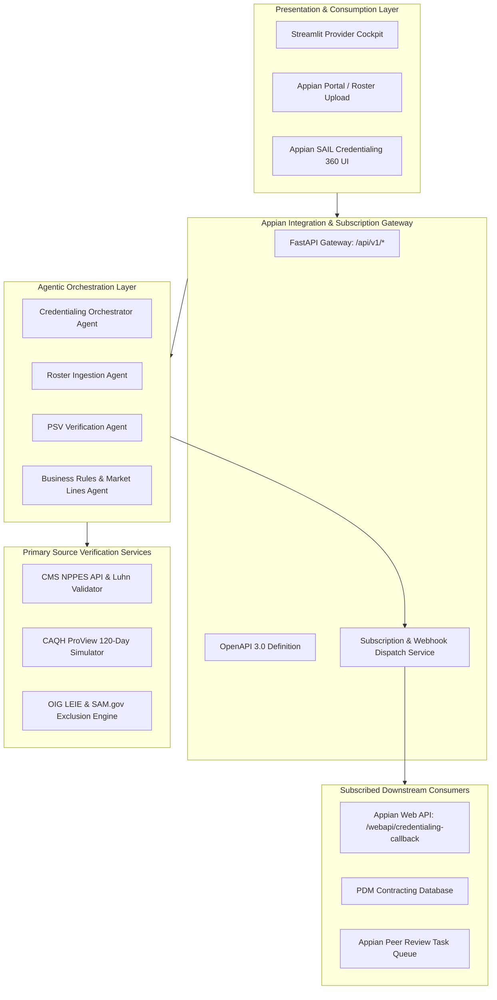
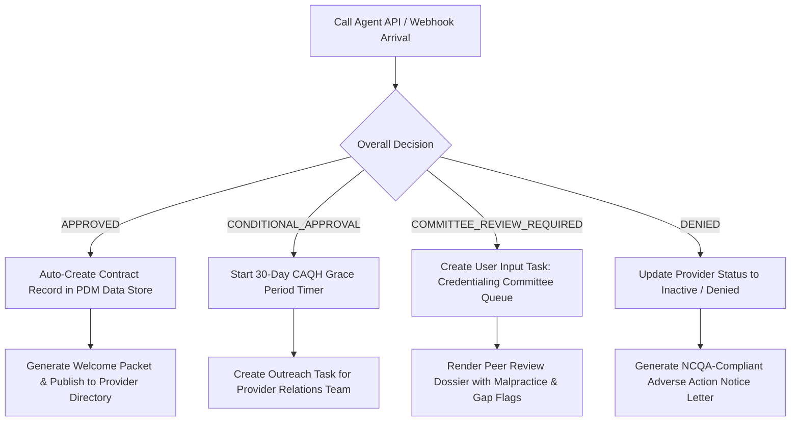

# Technical Design Document (TDD)
## Healthcare Provider Credentialing Approval Agentic System & Appian Automation

**Document Version**: 2.1.0  
**Status**: APPROVED / PRODUCTION READY  
**Author**: DeepMind Advanced Agentic Coding Team  
**Compliance**: NCQA (CR1–CR4), CMS Medicare/Medicaid Managed Care, HIPAA Security Rule, HL7 FHIR Practitioner  

---

## 1. Executive Summary & Purpose

The **Healthcare Provider Credentialing Approval Agentic System** is an autonomous, multi-agent platform designed for Healthcare Payers and Provider Management Systems (PMS/PDM). It automates the end-to-end credentialing lifecycle:
1. **Intake**: Ingestion of bulk provider rosters (CSV, JSON, Appian document base64).
2. **Primary Source Verification (PSV)**: Real-time validation against the CMS NPPES NPI Registry, CAQH ProView (120-day attestation currency rule), State Medical Boards, Education/Residency registries, 5-year work history gap detection, Federal DEA, COI Malpractice policies ($1M/$3M), and OIG LEIE / SAM.gov sanctions.
3. **Business Market Lines & Contracting**: Rules-based evaluation of participation across Commercial, Medicare Advantage, Medicaid Managed Care, and ACA Marketplace Exchange lines of business, calculating NCQA-mandated 36-month cycles, effective dates, and network tiers.
4. **Appian Workflow Automation**: Native REST API, OpenAPI 3.0 specs, Appian CDTs, Process Models, and SAIL interfaces.
5. **Agent Credentialing Service Subscription API**: An event-driven subscription and webhook dispatch engine providing continuous monitoring alerts (90-day recredentialing warnings, CAQH attestation lapses, sanction notifications).

---

## 2. System Architecture & Design Principles



### Architectural Principles:
* **Separation of Concerns**: Ingestion, PSV, Business Decisioning, and Orchestration are cleanly isolated into dedicated agents.
* **Idempotence & Auditability**: Every workflow run records a chronological, tamper-evident audit trail (`CredentialingAuditTrail`) with timestamp, agent name, and step action.
* **Fail-Safe & Graceful Degradation**: Offline mock fallbacks exist for CMS NPPES and CAQH ProView to ensure deterministic local development while supporting live production web services.
* **NCQA / CMS Standard Compliance**: Strictly implements the 120-day CAQH attestation currency limit, board certification requirements for Medicare Advantage, and 36-month recredentialing cycles.
* **Event-Driven Continuous Monitoring**: Subscribed systems (Appian) receive push notifications when milestones or risk events occur, eliminating polling overhead.

---

## 3. Multi-Agent Component Breakdown

### 3.1 Roster Ingestion Agent (`agents/roster_ingestion_agent.py`)
* **Role**: Ingests unstructured or semi-structured provider roster files.
* **Resilience**: Normalizes heterogeneous column headers (`NPI Number`, `National Provider Identifier`, `Provider NPI`, `Tax ID`, `TIN`, `Specialty Taxonomy`, `Practice State`).
* **Input**: File path (CSV/JSON), raw string content, or Appian Base64-decoded byte streams.
* **Output**: Strongly-typed list of `RosterProviderItem` models.

### 3.2 PSV Verification Agent (`agents/psv_verification_agent.py`)
* **Role**: Primary Source Verification across all 8 mandatory healthcare credentialing standards.
* **Verification Pipeline**:
  1. **NPI Registry Check**: Calls CMS NPPES API v2.1. Validates Luhn checksum algorithm, Type 1 (Individual) designation, active enumeration status, and deactivation flags.
  2. **CAQH ProView Attestation**: Calculates elapsed days since provider's last attestation. Enforces the strict NCQA 120-day currency standard.
  3. **State Medical Board License**: Verifies active license in practicing state, checks expiration date, and flags disciplinary actions.
  4. **Education & Medical Training**: Verifies medical school graduation, residency, and fellowship credentials.
  5. **5-Year Work History & Gap Analysis**: Analyzes timeline continuity. Automatically flags unaddressed employment gaps $> 6$ months.
  6. **Federal DEA & CDS**: Checks DEA registration validity, schedule authorisations (Schedules 2, 2N, 3, 3N, 4, 5), and expiration.
  7. **Malpractice Insurance Coverage**: Verifies certificate of insurance (COI), minimum required limits ($\$1,000,000 / \$3,000,000$), carrier A.M. Best rating, and 5-year claims settlement history.
  8. **Federal Sanctions & Exclusions**: Checks OIG List of Excluded Individuals/Entities (LEIE) and SAM.gov debarment lists.

### 3.3 Business Rules & Market Lines Agent (`agents/business_rules_agent.py`)
* **Role**: Applies payer-specific line-of-business (LOB) policies and assigns final credentialing committee decisions.
* **Rules Engine**:
  * Loads `config/market_lines_config.json`.
  * **Commercial**: Requires active state license, DEA, and minimum $\$1\text{M} / \$3\text{M}$ malpractice coverage.
  * **Medicare Advantage**: Requires active ABMS or AOA Board Certification in practicing specialty.
  * **Medicaid Managed Care**: Requires active state license in plan service state and Medicaid ID eligibility.
  * **ACA Marketplace Exchange**: Standard individual exchange qualifications.
* **Date Calculations**: Computes participation effective dates, 36-month NCQA term expirations, and 90-day recredentialing reminder deadlines.
* **Decision States**:
  * `APPROVED`: 100% clean PSV and full market line qualifications.
  * `CONDITIONAL_APPROVAL`: High-quality credentials but CAQH attestation lapsed ($>120$ days); granted 30-day grace period.
  * `COMMITTEE_REVIEW_REQUIRED`: Discretionary risks detected (e.g. malpractice claims, work history gaps, board consent orders).
  * `DENIED`: Hard legal/regulatory disqualifiers (deactivated NPI, revoked license, OIG exclusion).

### 3.4 Credentialing Orchestrator (`agents/credentialing_orchestrator.py`)
* Coordinates the multi-agent pipeline, aggregates audit records, handles batch summaries, and dispatches webhook events to registered Appian subscribers.

---

## 4. Agent Credentialing Service Subscription API

### 4.1 Architecture & Event Types
The subscription service provides an asynchronous, event-driven integration layer:

| Event Type | Description | Appian Trigger Action |
|---|---|---|
| `BATCH_COMPLETED` | Bulk roster file processing concluded | Starts batch summary report & notifications |
| `CREDENTIALING_COMPLETED` | Individual provider decision issued | Triggers contracting or committee queue |
| `RECREDENTIALING_ALERT` | Provider enters 90-day NCQA expiration window | Initiates re-credentialing packet in Appian |
| `CAQH_EXPIRATION_ALERT` | CAQH attestation exceeds 90 or 120 days | Assigns Provider Outreach Coordinator task |
| `SANCTION_DETECTED` | Provider matched to OIG/SAM exclusion | Initiates immediate network suspension |

### 4.2 Webhook Security & HMAC Verification
Outgoing webhooks include security headers:
* `X-CredAgent-Event`: Event identifier (e.g., `CREDENTIALING_COMPLETED`)
* `X-CredAgent-Event-Id`: Unique event UUID (`EVT-XXXXXXXXXXXX`)
* `X-CredAgent-Timestamp`: ISO-8601 UTC timestamp
* `Authorization`: `Bearer <token>` (if configured)
* `X-CredAgent-Signature`: `sha256=<hmac>` computed with the shared secret:
  $$\text{Signature} = \text{HMAC-SHA256}(\text{SecretKey}, \text{PayloadJSON})$$

---

## 5. Appian Workflow Automation Integration Specifications

### 5.1 Appian Connected System Setup
* **Name**: `CS_ProviderCredentialingAgent`
* **Base URL**: `http://localhost:8000` (or internal DNS)
* **Authentication**: `None` / `API Key`

### 5.2 Key REST Endpoints

```
POST /api/v1/provider/credential
POST /api/v1/roster/process
POST /api/v1/roster/process-base64
POST /api/v1/roster/process-json
POST /api/v1/subscriptions
GET  /api/v1/subscriptions
GET  /api/v1/subscriptions/{id}
PUT  /api/v1/subscriptions/{id}
DELETE /api/v1/subscriptions/{id}
POST /api/v1/subscriptions/{id}/test
POST /api/v1/subscriptions/scan-alerts
GET  /api/v1/market-lines
GET  /api/v1/health
GET  /api/v1/appian/openapi.json
```

### 5.3 Appian Process Model XOR Decision Routing


---

## 6. Visual Studio Code (VS Code) Local Run Guide

The repository includes complete, pre-configured VS Code settings:
* `.vscode/settings.json`: Python interpreter, auto-save, formatting on save, pytest enablement.
* `.vscode/launch.json`: Pre-configured 1-click debug targets:
  1. `🚀 1. Run Appian Credentialing API (FastAPI)`
  2. `🏥 2. Run Streamlit Dashboard`
  3. `📋 3. Run CLI Batch Roster Process`
  4. `🧪 4. Run Pytest Test Suite`
* `.vscode/tasks.json`: Quick tasks for dependency installation, running tests, and starting services.
* `.vscode/extensions.json`: Recommended extensions for Python, debugging, and REST client.

### Step-by-Step Local Setup in VS Code:
1. Open the project directory in VS Code:
   ```powershell
   code C:\Users\866223\.gemini\antigravity\scratch\provider_cred_agent
   ```
2. Create & activate a virtual environment:
   ```powershell
   python -m venv .venv
   .\.venv\Scripts\Activate.ps1
   ```
3. Install dependencies:
   ```powershell
   pip install -r requirements.txt
   ```
4. Run the automated test suite:
   ```powershell
   python -m pytest tests/test_cred_agent.py -v
   ```
5. Launch the application:
   * Press **F5** in VS Code and select `🚀 1. Run Appian Credentialing API (FastAPI)` to start the REST API on `http://localhost:8000`.
   * Press **F5** and select `🏥 2. Run Streamlit Dashboard` to start the interactive web cockpit on `http://localhost:8501`.
