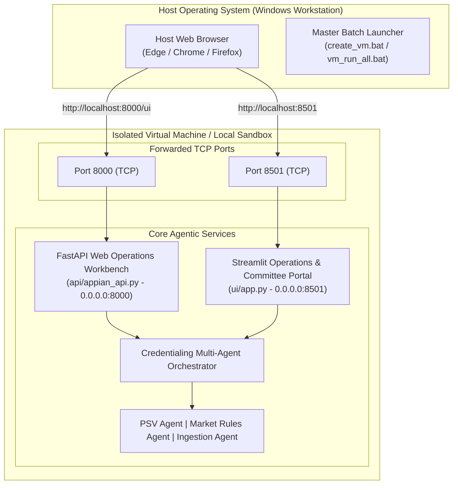
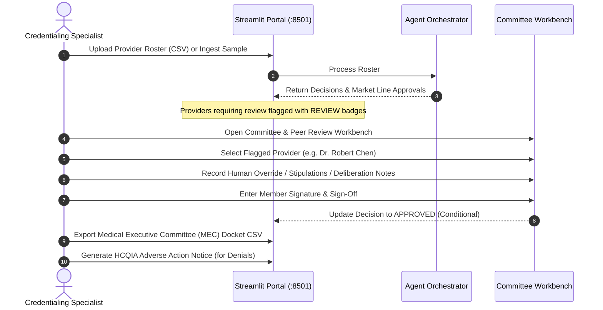

# Healthcare Provider Credentialing Approval Agentic System
## Comprehensive Local Virtual Machine (VM) Execution & Provisioning Guide

---

## 1. Executive Summary & Overview

This guide provides an end-to-end operational manual for deploying and executing the **Healthcare Provider Credentialing Approval Agentic Workflow** in an isolated local Virtual Machine (VM) or container sandbox.

The system is designed to run in five distinct local virtualization environments:
1. **Local Python Virtual Machine Sandbox (`.venv` VM)**: Instant, zero-overhead, isolated environment on Windows. (Recommended for instant setup).
2. **WSL2 Linux Virtual Machine**: Native Linux kernel running on Windows Subsystem for Linux (Ubuntu 22.04 LTS / 24.04 LTS).
3. **Windows Native Hyper-V VM**: Enterprise Type-1 hypervisor with internal NAT switch and static port mapping.
4. **VirtualBox / Vagrant Linux VM**: Automated headless Ubuntu 22.04 LTS virtual machine with pre-configured systemd background services.
5. **Docker Containerized VM Environment**: Multi-stage hardened non-root container deployment.

---

## 2. Virtual Machine Architecture & Host Bridging

When running inside any virtual machine or container, server processes must bind to `0.0.0.0` (all network adapters) rather than `127.0.0.1` (loopback only). This enables the host Windows browser to communicate across the virtual network bridge.



### Network Endpoints Inventory

| Service | Target URL | VM Binding | Description |
| :--- | :--- | :--- | :--- |
| **FastAPI Web Workbench** | `http://localhost:8000/ui` | `0.0.0.0:8000` | Zero-dependency single-page HTML5/Tailwind operations portal |
| **Streamlit Committee Portal** | `http://localhost:8501` | `0.0.0.0:8501` | Human-in-the-loop Committee review, dockets, adverse action letters |
| **Swagger API Docs** | `http://localhost:8000/docs` | `0.0.0.0:8000` | Interactive OpenAPI documentation and test client |
| **Appian OpenAPI Schema** | `http://localhost:8000/api/v1/appian/openapi.json` | `0.0.0.0:8000` | 1-click import schema for Appian Integration Designer |
| **System Health Check** | `http://localhost:8000/api/v1/health` | `0.0.0.0:8000` | Uptime, agent status, and active webhook subscriptions count |

---

## 3. Quickstart: 1-Click Master VM Creator (`create_vm.bat`)

The easiest way to initialize, provision, and run the system is using the master batch script [`create_vm.bat`](file:///c:/Users/866223/.gemini/antigravity/scratch/provider_cred_agent/create_vm.bat).

### Interactive Menu
Double-click `create_vm.bat` or run:
```cmd
create_vm.bat
```

You will be presented with the interactive menu:
```
==============================================================================
  Healthcare Provider Credentialing Approval Agentic Workflow
  Automated Local Virtual Machine (VM) Creator & Provisioner
==============================================================================

  Detected Virtualization & Runtime Options on this Host:
    [x] Python Runtime:          Python 3.13.2 (Installed)
    [x] WSL2 Linux Subsystem:    Available
    [ ] Vagrant Virtual Machine: Not found in PATH
    [ ] Docker Container VM:     Not found in PATH

==============================================================================
  Please select a Virtual Machine deployment option:
==============================================================================
  [1] Local Python Virtual Machine Sandbox (.venv)  [Recommended / Instant]
  [2] WSL2 Linux Virtual Machine                    [Native Linux on Windows]
  [3] Windows Hyper-V Virtual Machine               [Native Windows Hypervisor]
  [4] Vagrant / VirtualBox Linux VM                 [Ubuntu 22.04 LTS Headless]
  [5] Docker Containerized VM Environment           [Multi-Stage Containers]
  [6] Run Automated Pytest Suite inside VM
  [7] Launch All VM Services (Web Workbench + Streamlit Portal)
  [0] Exit
==============================================================================
```

### Unattended / Direct CLI Arguments

You can also bypass the menu and run direct provisioning commands:

```cmd
# Create and verify the isolated virtual environment sandbox (.venv):
create_vm.bat --venv

# Execute the 14-test verification suite inside the VM:
create_vm.bat --test

# Concurrently launch both services (FastAPI + Streamlit) and open host browser:
create_vm.bat --start

# Provision WSL2 Linux VM:
create_vm.bat --wsl

# Provision Windows Hyper-V VM:
create_vm.bat --hyperv

# Provision Vagrant / VirtualBox Linux VM:
create_vm.bat --vagrant
```

For PowerShell users, [`create_vm.ps1`](file:///c:/Users/866223/.gemini/antigravity/scratch/provider_cred_agent/create_vm.ps1) supports identical modes:
```powershell
.\create_vm.ps1 -Mode venv
.\create_vm.ps1 -Mode test
.\create_vm.ps1 -Mode start
```

---

## 4. Step-by-Step Deployment Methods

### Method 1: Local Virtual Environment Sandbox (`.venv` VM) - Recommended

This method creates a sandboxed virtual execution environment locally on Windows. It requires zero third-party hypervisor software and provides complete environment isolation.

#### Step 1: Provision Environment
```cmd
create_vm.bat --venv
```
This automatically:
1. Creates the `.venv` sandbox directory.
2. Upgrades `pip`, `wheel`, and `setuptools`.
3. Installs all required packages (`fastapi`, `uvicorn`, `pydantic`, `pandas`, `streamlit`, `pytest`, `httpx`).
4. Executes the full 14-test verification suite.
5. Configures networking environment variables (`HOST=0.0.0.0`, `PORT=8000`, `UI_PORT=8501`).

#### Step 2: Launch Services
You can launch individual services or everything simultaneously:

- **Launch Everything**: Double-click [`vm_run_all.bat`](file:///c:/Users/866223/.gemini/antigravity/scratch/provider_cred_agent/vm_run_all.bat).
  - Starts FastAPI in one window.
  - Starts Streamlit in a second window.
  - Automatically opens `http://localhost:8000/ui` and `http://localhost:8501` in your browser.
- **FastAPI Workbench Only**: Run [`vm_start_api.bat`](file:///c:/Users/866223/.gemini/antigravity/scratch/provider_cred_agent/vm_start_api.bat).
- **Streamlit Committee Portal Only**: Run [`vm_start_ui.bat`](file:///c:/Users/866223/.gemini/antigravity/scratch/provider_cred_agent/vm_start_ui.bat).

---

### Method 2: WSL2 Linux Virtual Machine

WSL2 allows running genuine Linux (Ubuntu) side-by-side with Windows, using native Linux system calls and networking.

#### Prerequisites:
If WSL is not yet installed on your Windows machine, open PowerShell as Administrator and run:
```powershell
wsl --install
```
*(Reboot your PC when prompted)*.

#### Step 1: Provision WSL Environment
Run:
```cmd
create_vm.bat --wsl
```
Or execute directly inside WSL:
```bash
bash scripts/provision_wsl.sh
```

#### What this does:
1. Installs Python 3, `pip`, and `python3-venv` inside Ubuntu.
2. Creates an isolated Linux virtual environment (`.venv_linux`).
3. Installs project requirements and executes the test suite.
4. Binds both services to `0.0.0.0`.
5. WSL2 automatically mirrors ports 8000 and 8501 to Windows `localhost`.

#### Host Access:
- Open `http://localhost:8000/ui` in your Windows browser.
- Open `http://localhost:8501` in your Windows browser.

---

### Method 3: Windows Native Hyper-V Virtual Machine

For enterprise environments requiring a Type-1 hardware-isolated virtual machine.

#### Prerequisites:
- Windows 10/11 Pro, Enterprise, or Education edition.
- Hyper-V feature enabled (`Enable-WindowsOptionalFeature -Online -FeatureName Microsoft-Hyper-V -All`).

#### Step 1: Provision Hyper-V Virtual Switch & NAT
Run:
```cmd
create_vm.bat --hyperv
```
Or execute in PowerShell as Administrator:
```powershell
powershell.exe -ExecutionPolicy Bypass -File scripts\provision_hyperv.ps1
```

#### What this script configures:
1. **Internal Virtual Switch**: Named `CredAgentNatSwitch`.
2. **NAT Gateway Subnet**: `192.168.120.0/24` with Gateway IP `192.168.120.1`.
3. **Static Port Forwarding Rules**:
   - Host TCP `8000` ➔ VM `192.168.120.10:8000` (FastAPI Workbench)
   - Host TCP `8501` ➔ VM `192.168.120.10:8501` (Streamlit Portal)
4. **VM Specification**: Generation 2 VM, 2 vCPUs, 2GB dynamic memory, 30GB VHDX virtual disk.

#### Step 2: Install Guest OS & Run Agent
1. Boot the VM with your Linux ISO (e.g. Ubuntu 22.04 LTS).
2. Configure static IP `192.168.120.10/24` on the VM adapter with Gateway `192.168.120.1`.
3. Clone or copy the project files to the VM.
4. Run `python run_agent.py --web` and `python run_agent.py --ui`.
5. Access immediately from your Windows host browser at `http://localhost:8000/ui` and `http://localhost:8501`.

---

### Method 4: VirtualBox / Vagrant Linux VM (Ubuntu 22.04 LTS)

Turnkey, fully-automated headless Linux VM setup managed by Vagrant.

#### Prerequisites:
1. Install [VirtualBox](https://www.virtualbox.org/).
2. Install [Vagrant](https://www.vagrantup.com/).

#### Step 1: Provision and Launch VM
Run:
```cmd
create_vm.bat --vagrant
```
Or directly:
```cmd
vagrant up
```

#### Automated Shell Provisioning:
The included [`Vagrantfile`](file:///c:/Users/866223/.gemini/antigravity/scratch/provider_cred_agent/Vagrantfile) automatically:
1. Downloads and boots `bento/ubuntu-22.04`.
2. Allocates 2 CPUs and 2048 MB RAM.
3. Maps Guest Port 8000 ➔ Host Port 8000.
4. Maps Guest Port 8501 ➔ Host Port 8501.
5. Installs Python 3, builds a virtual environment in `/opt/cred_agent_venv`, and installs dependencies.
6. Runs the 14-test pytest suite.
7. Creates and enables two **systemd background services**:
   - `cred-agent-api.service`: Runs the FastAPI server automatically on boot.
   - `cred-agent-ui.service`: Runs the Streamlit UI portal automatically on boot.

#### VM Lifecycle Commands:
```cmd
vagrant status     # Check VM state
vagrant ssh        # SSH into the Ubuntu VM
vagrant halt       # Safely shut down the VM
vagrant reload     # Restart the VM
vagrant destroy    # Tear down and delete the VM
```

---

### Method 5: Docker Containerized VM Environment

If Docker Desktop is installed on the host machine:

```cmd
# Build images and start container stack in background:
docker-compose up --build -d

# View running container status:
docker-compose ps

# Tail live application logs:
docker-compose logs -f

# Shut down containers:
docker-compose down
```

---

## 5. Operating the Agentic Credentialing Workflow from Host Browser

Once your VM is running, open your web browser on the host machine.

### UI Option A: Streamlit Operations & Committee Portal (`http://localhost:8501`)

The Streamlit portal provides a comprehensive human-in-the-loop governance interface:



#### Key Capabilities:
1. **Intake & Verification Tab**:
   - Upload any custom CSV/JSON roster, or click **"Load & Process Default Sample Roster"** to immediately test 4 pre-configured clinical scenarios.
   - View KPI summary tiles (Total Processed, Clean Approvals, Conditional Approvals, Committee Reviews Required, Denials).
2. **Committee & Peer Review Workbench**:
   - Select any provider whose case was escalated for committee peer review (e.g., malpractice claims, unexplained work gaps).
   - Enter committee member names, review notes, risk mitigation stipulations (e.g. 100% chart review for 90 days), and electronic sign-offs.
   - Override decisions with full immutable audit logging.
3. **MEC Docket & Adverse Action Letters**:
   - Export official Medical Executive Committee approval dockets as CSV.
   - 1-click generator for formal Health Care Quality Improvement Act (HCQIA) Adverse Action notice letters with reason codes, appeal rights, and 30-day deadlines.
4. **On-Demand Single Provider Verification**:
   - Lookup and credential an individual provider by NPI (e.g. `1234567893`), First Name, Last Name, and Practice State.
5. **Continuous Monitoring & Alert Scanner**:
   - Run live network scans for 90-day NCQA recredentialing deadlines, expired CAQH attestations, and active sanctions.

---

### UI Option B: Embedded Web Operations Workbench (`http://localhost:8000/ui`)

A lightweight, zero-dependency HTML5 dashboard served directly by FastAPI:
- 1-Click **Process Sample Roster** button.
- Drag-and-drop CSV roster upload with instant interactive data tables.
- Real-time decision filtering (`ALL`, `APPROVED`, `CONDITIONAL`, `COMMITTEE_REVIEW`, `DENIED`).
- Direct links to Swagger Docs (`/docs`) and Health Check (`/api/v1/health`).

---

## 6. Automated Test Suite Verification

To verify that all components are functioning properly inside the VM environment, run:

```cmd
create_vm.bat --test
```

### Test Coverage Summary (14 Tests):

```
============================= test session starts =============================
platform win32 -- Python 3.13.2, pytest-9.1.1
rootdir: C:\Users\866223\.gemini\antigravity\scratch\provider_cred_agent

tests/test_cred_agent.py::test_npi_luhn_algorithm PASSED                 [  7%]
tests/test_cred_agent.py::test_roster_ingestion_normalization PASSED     [ 14%]
tests/test_cred_agent.py::test_clean_provider_full_approval PASSED       [ 21%]
tests/test_cred_agent.py::test_expired_caqh_conditional_approval PASSED  [ 28%]
tests/test_cred_agent.py::test_malpractice_claims_committee_review PASSED [ 35%]
tests/test_cred_agent.py::test_suspended_license_and_sanction_denial PASSED [ 42%]
tests/test_cred_agent.py::test_batch_roster_processing PASSED            [ 50%]
tests/test_cred_agent.py::test_batch_roster_json_processing PASSED       [ 57%]
tests/test_cred_agent.py::test_appian_api_health_endpoint PASSED         [ 64%]
tests/test_cred_agent.py::test_appian_api_single_provider_credential PASSED [ 71%]
tests/test_cred_agent.py::test_subscription_lifecycle PASSED             [ 78%]
tests/test_cred_agent.py::test_continuous_monitoring_alert_scan PASSED   [ 85%]
tests/test_cred_agent.py::test_web_workbench_ui_routes PASSED            [ 92%]
tests/test_cred_agent.py::test_process_sample_roster_endpoint PASSED     [100%]

======================== 14 passed, 1 warning in 5.01s ========================
```

---

## 7. Windows Defender Firewall Configuration

If accessing services across external VM hypervisors (Hyper-V or VirtualBox bridged networking), allow inbound traffic on TCP ports 8000 and 8501:

Open PowerShell as Administrator on the host machine:
```powershell
New-NetFirewallRule -DisplayName "Credentialing Agent Web Workbench (8000)" -Direction Inbound -LocalPort 8000 -Protocol TCP -Action Allow
New-NetFirewallRule -DisplayName "Credentialing Agent Streamlit Portal (8501)" -Direction Inbound -LocalPort 8501 -Protocol TCP -Action Allow
```

---

## 8. Troubleshooting & FAQ

### Q1: Browser displays `ERR_CONNECTION_REFUSED` when opening `http://localhost:8000/ui`
- **Cause**: The service inside the VM may have bound to `127.0.0.1` instead of `0.0.0.0`, or port forwarding is not active.
- **Fix**: Verify `HOST=0.0.0.0` is set in the environment. Ensure `vm_start_api.bat` or `run_agent.py --web` is running.

### Q2: Port 8000 or 8501 is already in use by another application
- **Fix**: You can launch with custom ports:
  ```cmd
  set PORT=8080
  set UI_PORT=8502
  python run_agent.py --web --port 8080
  python run_agent.py --ui --ui-port 8502
  ```

### Q3: Streamlit crashes or fails to launch in headless VM
- **Cause**: In Linux or headless VMs, Streamlit may attempt to open a desktop browser.
- **Fix**: Always pass `--server.headless true` and `--server.address 0.0.0.0`. Both `create_vm.bat`, `run_agent.py`, and `Vagrantfile` include these flags automatically.

### Q4: Hyper-V script gives permission error
- **Cause**: Hyper-V Virtual Switch and NAT configuration requires elevated Administrator rights.
- **Fix**: Right-click PowerShell and select **"Run as Administrator"**, then run `scripts\provision_hyperv.ps1`.

---

## 9. Git Repository Policy Reminder

> [!IMPORTANT]
> **Strict Local Isolation Notice**: All files, virtual machines, and configurations created during this setup remain strictly in your local workspace. In accordance with user policy, **no commits or pushes to GitHub have been made or will be made** until you issue an explicit instruction to push.
